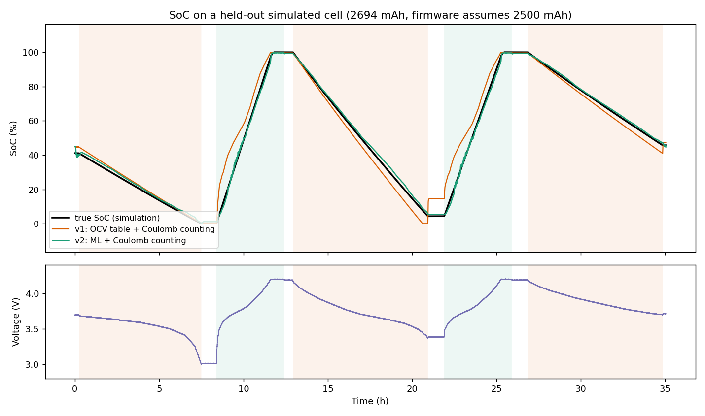
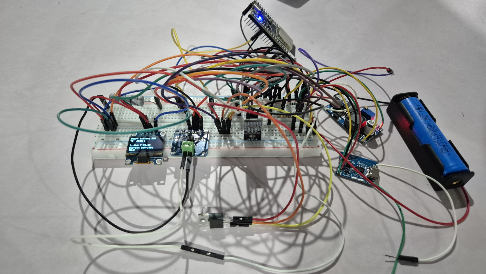
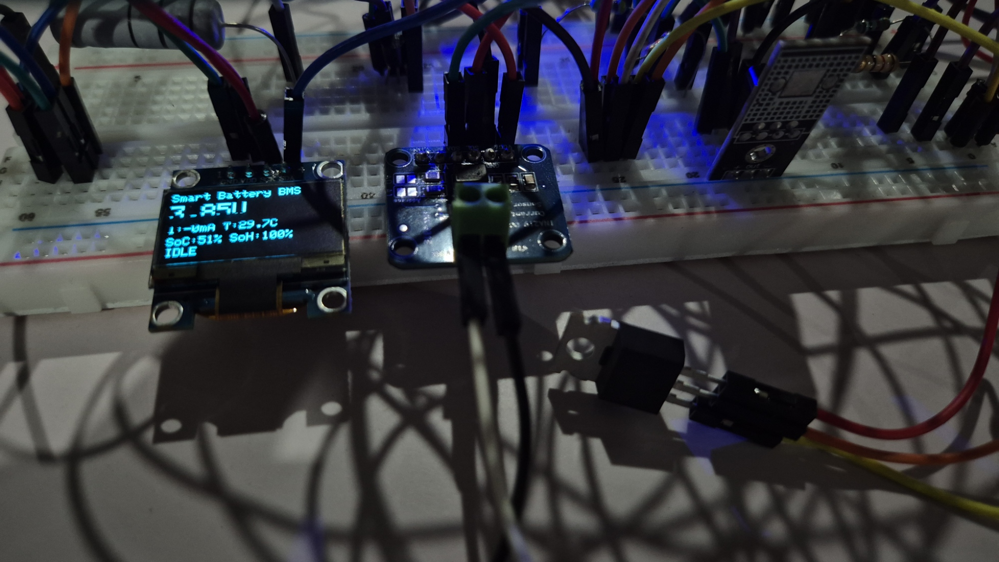
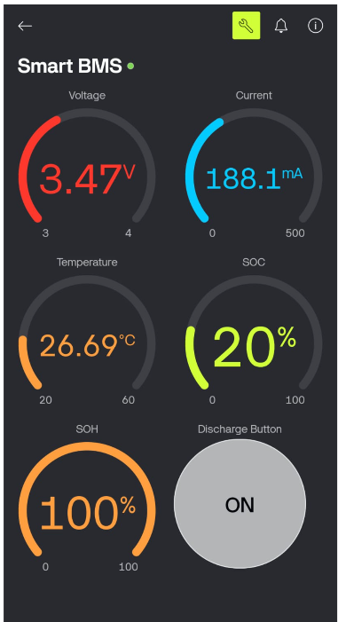

# 🔋 Smart Battery Management System (BMS)
 
A single-cell Battery Management System built on ESP32 for real-time monitoring of a Li-ion cell's voltage, current, temperature, and estimated State of Charge (SoC), with live telemetry on an OLED display and a Blynk IoT dashboard.

The repo has two firmware versions for the same hardware:

- **v1** (`code/smart_bms/`) is the original rule-based BMS described below.
- **v2** (`code/smart_bms_ml/`) adds on-device machine learning: an ML SoC estimator, an anomaly detector, SoH and time-to-empty. See [ML-Enhanced Version (v2)](#-ml-enhanced-version-v2).
 
---
 
## 🚀 Features
 
- ⚡ Real-time voltage and current monitoring via INA219 (I2C)
- 🌡️ Temperature monitoring via DS18B20 (1-Wire)
- 🔋 State of Charge (SoC) estimation using an OCV lookup table, corrected with Coulomb counting during discharge and smoothed with an exponential filter
- 🔌 Charging vs. idle/discharge detection using a debounced voltage-slope algorithm
- 🛡️ Safety threshold enforcement (undervoltage, overcurrent, overtemperature) with a latched fault state — the MOSFET is forced to its safe/idle state on any violation and stays there until explicitly cleared via serial command, and only if the triggering condition has resolved
- ⏱️ Timer-interrupt-driven sampling: a hardware timer fires at a fixed interval and signals the main loop via a semaphore, replacing blocking `delay()`-based polling; sampling jitter and ISR-fire vs. samples-processed counts are tracked for verification
- 📱 Live telemetry pushed to a Blynk IoT dashboard
- 📟 OLED display showing voltage, current, temperature, SoC, and fault status
- 🎛️ Manual discharge-cycle control via serial commands (`D` to start discharge, `S` to stop, `C` to clear a latched fault, `J` to print sampling/jitter stats), which also switches a MOSFET on `GPIO26`
---
 
## 🛠️ Tech Stack
 
- **Microcontroller:** ESP32
- **Sensors:** INA219 (voltage/current), DS18B20 (temperature)
- **Display:** OLED (SSD1306)
- **IoT Platform:** Blynk
- **Language:** Arduino (C++)
- **ML (v2):** scikit-learn for training (Python); on-device inference in plain C++
---
 
## ⚙️ Working
 
1. A hardware timer interrupt fires every 1 second and signals the main loop via a semaphore; the loop reads voltage, current, and temperature when signaled, rather than polling on a blocking `delay()`. The ISR itself only increments a counter and gives the semaphore — the actual I2C/1-Wire reads happen in the main loop, since both buses are too slow/blocking to run safely inside interrupt context.
2. On each sample, voltage, current, and temperature are checked against fixed thresholds (`CUTOFF_VOLTAGE`, `MAX_CURRENT`, `MAX_TEMP`). Any violation forces the MOSFET to its safe/idle state, blocks further discharge start, and latches a fault flag that will not auto-clear — it requires an explicit `C` command, which itself only clears the latch if the most recent readings are back within safe limits.
3. Detects charging vs. discharging/idle by tracking the sign and persistence of short-term voltage changes (a rising/falling sample counter constrained to 0–20, with charging flagged once the counter crosses a threshold and the cell is below 4.18 V).
4. Estimates SoC:
   - On discharge (`current_mA > 5`): subtracts drawn charge from the running SoC using Coulomb counting against a fixed rated capacity.
   - Otherwise (charging or idle): blends the current SoC estimate toward a fresh OCV-table lookup (a different blend weight is used depending on whether the cell is charging or idle).
   - The result is passed through an additional exponential smoothing filter before display.
5. Displays voltage, current, temperature, filtered SoC, and fault status on the OLED and streams the same values to the Blynk dashboard.
6. Accepts serial commands to manually start/stop a discharge cycle (`D`/`S`), clear a latched fault (`C`), and print sampling/jitter diagnostics (`J`), toggling the MOSFET on `GPIO26` accordingly.
---

## 🤖 ML-Enhanced Version (v2)

`code/smart_bms_ml/smart_bms_ml.ino` runs on the same hardware. It keeps all of v1's fault protection, and the fixed thresholds still control the MOSFET. On top of that it adds:

- 🧠 **ML SoC estimation.** A small neural network estimates SoC from voltage, current, temperature and their recent trends. It continuously corrects Coulomb counting for a wrong rated capacity, sensor offsets and charge current the INA219 can't see. The v1 estimator still runs alongside for comparison.
- 🚨 **Anomaly detection.** A Gaussian mixture model learns what normal behaviour looks like. It warns about unusual heating or voltage drops (for example an internal short) before the 50 °C hard limit trips. The warning stays latched until acknowledged with `C`.
- 🔋 **State of Health.** A discharge from ≥95 % to the cutoff measures the real capacity, which updates SoH (stored in flash) and the capacity the SoC uses.
- ⏳ **Time to empty**, shown while discharging.
- 📱 **Blynk telemetry and control.** The v1 sketch in this repo never calls `Blynk.virtualWrite`, and its V5 discharge switch had no handler. v2 pushes all values every 5 s, the V5 switch starts and stops discharges, and the ML outputs appear on extra pins.
- 📝 **Data logging** (`L`) and an ML status command (`M`).

Results on held-out simulated cells: SoC error drops from **6.0 % to 2.3 % RMSE** (9.1 % → 2.7 % while charging). Internal shorts were caught in 15/15 runs and external heating in 14/15, with no false alarms in 292 h. The shipped model is trained on simulated data; retrain it on your own cell with the pipeline in [`ml/`](ml/README.md), which also covers how it works and its limitations.

### Fixes in v2 over v1

- A fully charged cell (4.2 V) no longer latches a sensor fault: the plausibility limit was 4.2 V, now 4.5 V.
- The DS18B20 read is non-blocking. v1 blocked ~750 ms out of every 1 s sample.
- An unreachable Blynk server no longer stalls the loop for 1 s on every pass.
- Coulomb counting uses the measured time between samples, so dropped samples no longer lose charge.
- Blynk is configured even if WiFi was down at boot.

### Blynk virtual pins (v2)

| Pin | Value | Pin | Value |
|---|---|---|---|
| V0 | Voltage (V) | V5 | Discharge switch (write 1/0) |
| V1 | Current (mA) | V6 | SoC, v1 estimator (%) |
| V2 | Temperature (°C) | V7 | Anomaly score |
| V3 | SoC, ML (%) | V8 | Anomaly warning (0/1) |
| V4 | SoH (%) | V9 | Time to empty (min, -1 if idle) |

Change the `VPIN_*` defines in the sketch if your template uses different pins.

---
## 📸 Project Images

### Hardware Setup

### OLED Output

### Blynk Dashboard

---

## 🔌 Circuit Components
 
- ESP32
- INA219 sensor
- DS18B20 temperature sensor
- OLED display
- MOSFET (IRLZ44N, driven through a BC548 transistor stage; switched both manually via serial command and automatically on a latched safety fault)
- Single Li-ion cell
---

## ▶️ How to Run

1. Clone the repository.
2. Install the **esp32 board package version 3.x** in the Arduino IDE. The sketches use the 3.x timer API (`timerBegin(frequency)`, `timerAlarm`).
3. Install the required libraries:
   - Adafruit INA219
   - DallasTemperature (with OneWire)
   - Adafruit SSD1306 (with Adafruit GFX)
   - Blynk
4. Open `code/smart_bms/smart_bms.ino` (v1) or `code/smart_bms_ml/smart_bms_ml.ino` (v2).
5. Copy `secrets_example.h` into that sketch's folder as `secrets.h` and fill in your WiFi and Blynk credentials. `secrets.h` is gitignored.
6. Upload to the ESP32.

---

## 📊 Future Improvements

- Multi-cell support with passive cell balancing
- CAN bus interface for automotive integration
- Cloud data logging
- Mobile app UI improvements
- Retrain the v2 models on logged data from the real cell

## 👩‍💻 Author

**Shriya Choksi**
