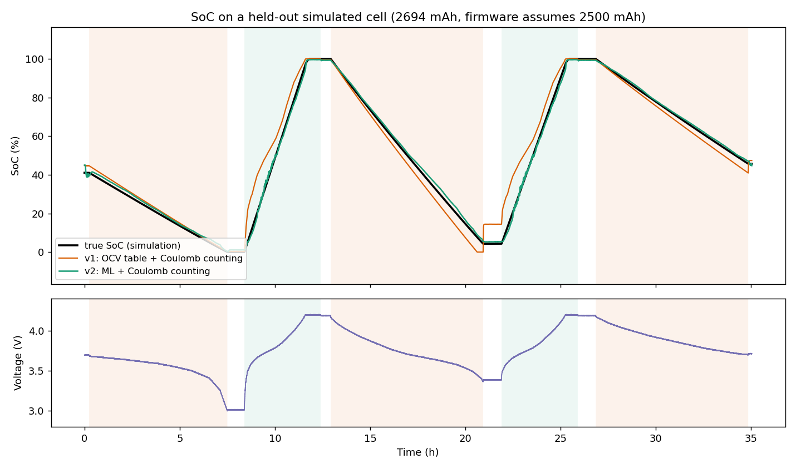
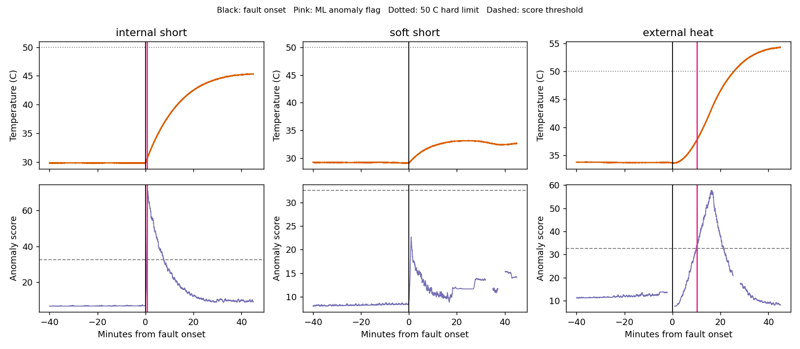

# ML pipeline for the Smart BMS (v2)

The v2 firmware (`code/smart_bms_ml/`) runs two small models on the ESP32, using the same sensors as v1:

- **SoC estimator.** An MLP (5 inputs → 16 → 16 → 1, about 400 weights) estimates SoC from voltage, current, temperature, window-average current and voltage slope. Its estimate corrects Coulomb counting a little each second. Coulomb counting tracks fast changes, and the MLP removes the drift that comes from the wrong rated capacity, sensor offsets and charge current the INA219 can't see.
- **Anomaly detector.** An 8-component Gaussian mixture model learns what normal behaviour looks like in terms of average current, voltage slope, temperature slope and SoC. A low likelihood sustained for 10 s raises a warning, before any fixed threshold trips. It is advisory by default (`ML_ANOMALY_TRIPS_FAULT 0`), so the fixed thresholds stay in charge of the MOSFET.

Both models only run when the cell is *settled*: the 60 s feature window is full and 3 min have passed since the load or charger switched, so the cell's polarisation has relaxed. In between, Coulomb counting carries the SoC on its own.

Inference is plain C++ in `bms_ml.h`, with no TensorFlow Lite or other dependencies. It costs roughly 1,000 multiply-adds and about 40 `tanhf`/`expf` calls per sample. That should be a few hundred microseconds on the ESP32, but this is an estimate, not a hardware measurement.

## Results (held-out simulated cells)

From `reports/metrics.json`. These cells were simulated; nothing here was measured on hardware yet.

| SoC error (RMSE) | v1: OCV table + Coulomb | v2: ML + Coulomb |
|---|---|---|
| All states | 6.0 % | **2.3 %** |
| Resting | 4.6 % | **2.1 %** |
| Discharging | 3.9 % | **2.1 %** |
| Charging | 9.1 % | **2.7 %** |
| Worst case | 25.9 % | **11.5 %** |

| Injected fault | Detected | Median time to warning | Lead over the 50 °C limit |
|---|---|---|---|
| Internal short (4–15 Ω) | 15 / 15 | 3.2 min | 11.5 min (2 of 15 never reached 50 °C) |
| External heating (1–3 °C/min) | 14 / 15 | 6.0 min | 17.5 min |
| Soft short (25–60 Ω) | 4 / 15 | 0.7 min (when detected) | never reached 50 °C |

There were no false alarms in 292 h of normal simulated operation.




## Workflow

```bash
pip install -r ml/requirements.txt

# 1. Train (synthetic bootstrap + any real logs) and export code/smart_bms_ml/ml_model.h
python ml/train_models.py            # ~4 min; --quick for a ~2 min smoke test

# 2. Check the firmware's C++ engine gives the same results as Python
python ml/tests/run_parity_test.py   # needs g++/clang++, or: pip install ziglang

# 3. Flash code/smart_bms_ml/smart_bms_ml.ino, then log real data
python ml/collect_data.py COM5 --discharge

# 4. Retrain with the logs in ml/data/real/ and flash again
python ml/train_models.py
```

**Collecting useful data.** SoC labels come from full discharges. Charge until the TP4056 finishes, rest the cell for at least 10 minutes, then discharge until the undervoltage cutoff stops it. The trainer labels that discharge 100 % → 0 % by integrating current. A few cycles, at different room temperatures if you can, are enough. The trainer weights real samples about equally with the simulated ones. Logging normal use also improves the anomaly model, since it learns what normal looks like on your setup.

## Files

| File | Purpose |
|---|---|
| `bms_reference.py` | Python mirror of `bms_ml.h`, used for training and evaluation |
| `cell_sim.py` | Synthetic data: Thevenin cell model, resistive load, TP4056 CC/CV, INA219/DS18B20 quantisation, thermal model, injected faults |
| `train_models.py` | Trains, tunes and evaluates both models; writes `ml_model.h`, `reports/` and parity vectors |
| `collect_data.py` | Logs the firmware's `L` CSV output from the serial port |
| `tests/` | Host build of `bms_ml.h` checked against Python sample-by-sample |

## Serial commands added in v2

- `L` toggles CSV logging.
- `M` prints ML status: features, MLP and fused SoC, anomaly score vs threshold, SoH, time to empty.
- `C` now also acknowledges a latched ML warning once the anomaly has cleared.

## Limitations

- **The shipped model is trained on simulated cells.** The simulator is calibrated to a typical 18650 on this bench, but your cell's OCV curve, resistance and thermal behaviour will differ. Retrain on real logs before trusting the numbers above, and before setting `ML_ANOMALY_TRIPS_FAULT 1`.
- **The anomaly detector reacts to changes**, such as fast heating or an unexplained voltage drop. A cell that has already settled into a faulty steady state can look normal, which is why the firmware latches the warning until you acknowledge it.
- **Small parasitic drains (under ~150 mA) are mostly missed.** On a single cell, their signature is too close to normal behaviour.
- **A 3-minute blind spot follows every load or charger switch.** The models wait for the cell to settle, and Coulomb counting covers the gap.
- **The models assume a 1 s sample interval.** The sketch has a `static_assert` that enforces this.
